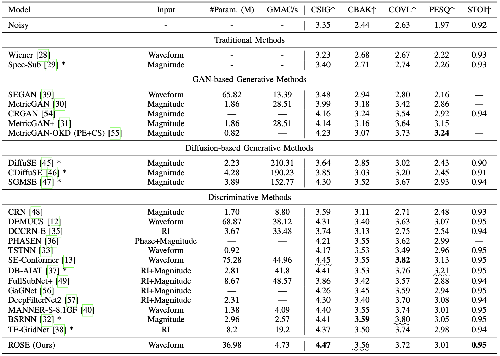

# ROSE: A Recognition-Oriented Speech Enhancement Framework in Air Traffic Control Using Multi-Objective Learning

**Xincheng Yu, Dongyue Guo, Jianwei Zhang, Yi Lin**

**Abstract:** Radio speech echo is a specific phenomenon in the air traffic control (ATC) domain, which degrades speech quality and further impacts automatic speech recognition (ASR) accuracy. In this work, a time-domain recognition-oriented speech enhancement (ROSE) framework is proposed to improve speech intelligibility and also advance ASR accuracy based on convolutional encoder-decoder-based U-Net framework, which serves as a plug-and-play tool in ATC scenarios and does not require additional retraining of the ASR model. Specifically, 1) In the U-Net architecture, an attention-based skip-fusion (ABSF) module is applied to mine shared features from encoders using an attention mask, which enables the model to effectively fuse the hierarchical features. 2) A channel and sequence attention (CSAtt) module is innovatively designed to guide the model to focus on informative features in dual parallel attention paths, aiming to enhance the effective representations and suppress the interference noises. 3) Based on the handcrafted features, ASR-oriented optimization targets are designed to improve recognition performance in the ATC environment by learning robust feature representations. By incorporating both the SE-oriented and ASR-oriented loss, ROSE is implemented in a multi-objective learning manner by optimizing shared representations across the two task objectives. The experimental results show that the ROSE significantly outperforms other state-of-the-art methods for both the SE and ASR tasks, in which all the proposed improvements are confirmed by designed experiments. In addition, the proposed approach can contribute to the desired performance improvements on public datasets.

Some audio examples can be found [here](https://xcyu-0903.github.io/ROSE-demo/)

## ROSE Architecture

## SE results on Voice Bank + DEMAND dataset

